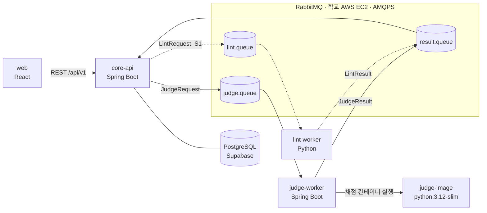

# 아키텍처

서버가 어떤 서비스로 나뉘고, 서로 어떻게 연결되며, 로컬과 운영에서 각각 어디서 도는지 적는다. 왜 이렇게 정했는지는 `docs/adr/`에 있고, 기능과 채점 규칙은 Notion 기획서에 있다. 아직 정하지 않은 것은 **(미정)**, 실제로 만들어 봐야 아는 것은 **(검증 전)**으로 표시했다.

## 1. 전체 흐름



제출 한 건의 경로는 이렇다. 점선은 Should(S1) 이후에 붙는 lint 경로다.

1. web이 `core-api`에 코드를 제출한다. core-api는 제출을 저장하고 `judge.queue`에 메시지를 넣은 뒤 바로 응답한다. S1부터는 `lint.queue`에도 넣는다.
   - DB 저장과 큐 발행은 한 트랜잭션이 아니다. 발행이 실패한 제출이 '대기'에 남지 않게 하는 방법(커밋 후 발행 + 재시도, 또는 멈춘 제출을 다시 발행하는 정리 작업)은 **(미정)**.
2. `judge-worker`가 `judge.queue`에서 꺼내 `JudgeStarted`를 `result.queue`로 보내고(core-api가 `RUNNING`으로 바꾼다), 채점 컨테이너를 띄워 테스트케이스를 전부 실행한 뒤 판정(`JudgeResult`)을 `result.queue`로 보낸다.
3. `lint-worker`가 `lint.queue`에서 꺼내 허용 요소를 검사하고 FLAG 결과를 `result.queue`로 보낸다. core-api는 이 결과를 기다리지 않는다. 판정은 LintResult 없이 확정된다.
4. core-api가 `result.queue`를 받아 저장한다. 큐는 at-least-once라 같은 메시지가 두 번 올 수 있다. 중복 제거 키는 `submission_id`만이 아니라 **`(submission_id, 결과 종류)`**다. 제출 하나에 JudgeStarted·JudgeResult·LintResult가 따로 오기 때문이다. 중복 제거는 DB 제약(유니크) 또는 상태 전이 조건으로 한다(`contracts/README.md`, `docs/erd.md` §5).

워커는 core-api를 호출하지 않는다. 의존은 core-api → 큐 → 워커 → 큐 → core-api 한 방향이다.

## 2. 서비스

| 서비스 | 구현 | 폴더 | 하는 일 | 담당 |
| --- | --- | --- | --- | --- |
| core-api | Spring Boot (Java 21) | `core-api/` | 인증, 수업·과제·문제, 제출 접수, 결과 저장, 점수, 관리자 현황 | A |
| judge-worker | Spring Boot (Java 21) | `judge-worker/` | `judge.queue` 소비, 채점 컨테이너 실행, 판정, 결과 발행 | B |
| lint-worker | Python | `lint-worker/` | `lint.queue` 소비, `ast` 기반 허용 요소 검사, 결과 발행. S1 | A |
| web | React | `autota-web` 저장소 | 학생·교수·관리자 화면. 앱 하나에 역할별 라우트 | 프론트 |

`judge-image/`는 서비스가 아니라 judge-worker가 띄우는 채점 컨테이너의 이미지다(B 담당). python:3.12-slim 위에 실행 스크립트가 들어 있고, 입력 주입·CPU 시간과 메모리 상한·종료 코드 기록을 맡는다.

서비스마다 독립 Gradle(또는 Python) 프로젝트이고 각자 이미지로 빌드한다. 다른 서비스의 코드를 import하지 않는다. 서비스 사이에서 공유하는 것은 `contracts/`의 메시지 정의뿐이다.

### core-api 내부

도메인별 레이어드 구조다. 멀티모듈은 아니다.

```
core-api/src/main/java/com/autota/server/
├─ domain/{도메인}/{controller,service,repository,entity,dto,exception}
└─ global/{common,exception,security,config}
```

도메인 목록은 `docs/conventions/git-convention.md` §2의 scope 표를 따른다. 다른 도메인의 데이터가 필요하면 그 도메인의 service를 호출하고 repository는 직접 쓰지 않는다. 컨트롤러는 역할별로 나눈다(`StudentProblemController`, `ProfessorProblemController`).

### judge-worker 내부

| 패키지 | 하는 일 |
| --- | --- |
| `consumer` | `judge.queue` 소비, 실패 재시도, 반복 실패는 DLQ로 격리 |
| `runner` | `JudgeRunner` 인터페이스. `DockerRunner`(로컬), `KubernetesRunner`(운영). 프로파일로 선택 |
| `judge` | 테스트케이스 그룹별 실행, 출력 비교, AC·WA·TLE·MLE·RE 판정, CPU 시간·메모리 측정 |
| `publisher` | `result.queue`로 JudgeResult 발행 |

제출 1건 = 채점 컨테이너(운영에서는 K8s Job) 1개이고, 테스트케이스는 그 안에서 모두 실행한다. 결과는 컨테이너의 표준 출력으로 받고, 메모리 초과는 컨테이너 종료 상태(OOMKilled)로 구분한다.

## 3. 큐

RabbitMQ 하나를 세 서비스가 같이 쓴다. 운영 브로커는 **클러스터 밖, 학교 AWS EC2 1대**에 docker compose로 띄우고 AMQPS(5671, TLS)로 붙는다(ADR 0012). 로컬은 compose의 RabbitMQ다. 큐는 durable, 메시지는 persistent라 AKS를 내렸다 올려도 메시지가 남는다. EC2에는 EIP를 붙여 주소를 고정하고, 학교 계정에서는 도메인을 쓸 수 없어 TLS는 자체 서명 CA로 한다. 보안 그룹 인바운드 규칙은 팀이 직접 추가할 수 있다(2026-11-09 조교 확인).

| 큐 | 보내는 쪽 | 받는 쪽 | 메시지 |
| --- | --- | --- | --- |
| `judge.queue` | core-api | judge-worker | `JudgeRequest` |
| `lint.queue` | core-api | lint-worker | `LintRequest` (S1) |
| `result.queue` | judge-worker, lint-worker | core-api | `JudgeStarted`, `JudgeResult`, `LintResult` |
| `judge.dlq` | 브로커 (delivery-limit 초과) | core-api | 한도를 넘긴 `JudgeRequest`. `FAILED` 처리 |
| `lint.dlq`, `result.dlq` | 브로커 | 소비 안 함 | 관리 UI에서 확인 |

큐는 모두 quorum 타입이고 `delivery-limit` 3, dead letter는 `at-least-once`다. 큐·exchange는 서비스가 선언하지 않고 RabbitMQ definitions(compose, `infra/ec2/`)로 만든다. 채점 자체가 실패하면 judge-worker가 `basic.reject`로 돌려보내다가 4회째에 `JudgeResult FAILED`를 보낸다. 자세한 규칙은 `contracts/README.md`.

메시지 필드 정의와 예시는 `contracts/`에 둔다. 각 서비스는 그 정의를 보고 자기 폴더에 record(또는 dataclass)를 복사해 쓴다. 필드는 추가만 하고, 삭제·이름 변경은 A·B 합의 후 별도 PR로 한다.

## 4. 채점 격리

같은 제한을 로컬과 운영에서 각각 다른 수단으로 건다.

| 항목 | 로컬 (`DockerRunner`) | 운영 (`KubernetesRunner`) |
| --- | --- | --- |
| CPU 시간 | 컨테이너 cgroup `cpu.stat`로 측정해 판정. `RLIMIT_CPU`는 안전장치(ADR 0004) | 같음 |
| 벽시계 상한 | CPU 시간이 쌓이지 않는 대기 코드를 끊는 안전 상한(CPU 제한의 몇 배). 넘으면 TLE | 같음 |
| 메모리 상한 | 케이스마다 자식 프로세스에 `RLIMIT_AS`, 값은 `ru_maxrss`. 컨테이너 `--memory`는 안전장치(ADR 0004) | 케이스마다 `RLIMIT_AS`, `resources.limits`(request = limit)는 안전장치 |
| 출력 상한 | 1MB 초과 시 중단, RE | 같음 |
| 네트워크 | `--network none` | NetworkPolicy로 judge 네임스페이스 ingress·egress 기본 거부. Pod에는 네트워크를 끄는 옵션이 없다 |
| 파일시스템 | `--read-only` + 작업 디렉터리만 쓰기 | `readOnlyRootFilesystem` + `emptyDir` 작업 디렉터리 |
| 사용자·권한 | `--user`, `--cap-drop ALL` | `runAsNonRoot`, `capabilities.drop: [ALL]` |
| 프로세스 수 | `--pids-limit` | Pod spec으로는 못 건다. 노드 풀 kubelet 설정(`podMaxPids`)으로 걸거나, 실행 스크립트의 `RLIMIT_NPROC`로 양쪽 공통 적용 **(미정)** |
| 배치 | — | 채점 노드 풀에 taint, Job에 toleration. 다른 워크로드는 못 오지만 DaemonSet(kube-proxy, CNI 등)은 모든 노드에 뜬다 |

NetworkPolicy는 정책을 지원하는 네트워크 플러그인이 없으면 에러 없이 무시된다. AKS 기본값은 `networkPolicy: none`이라 클러스터 생성 시 정책 엔진을 명시해서 켜고, 채점 Pod 안에서 외부 접속이 실패하는지 테스트로 확인한다.

시간 제한은 wall-clock이 아니라 CPU 시간으로 판정한다(이유는 `docs/adr/`). 버스트형 노드가 크레딧 소진으로 조여진 상태에서도 CPU 시간 측정이 일정한지는 **(검증 전)**이다. 크레딧이 찬 상태와 소진된 상태에서 같은 코드를 재채점해 판정이 일치하는지 사전 기간에 측정한다.

## 5. 실행 환경

### 로컬 (docker compose)

루트 `docker-compose.yml` 하나로 전부 뜬다. Must 완료 기준의 시연 환경이다.

| 구성 요소 | 어디서 |
| --- | --- |
| core-api, judge-worker, lint-worker | compose 서비스 |
| RabbitMQ | compose 서비스 |
| PostgreSQL | compose 서비스 (`sql/schema.sql`, `sql/seed.sql`로 초기화) |
| judge-image | compose가 먼저 빌드한다. judge-worker가 기동 전에 이미지가 있어야 한다 |
| 채점 컨테이너 | judge-worker가 호스트 Docker 소켓(`/var/run/docker.sock`)을 마운트해 호스트 Docker로 띄운다 |

Docker 소켓 마운트는 호스트 root 권한과 같다. 로컬 전용이고 운영에는 없다. judge-worker가 컨테이너 안에서 호스트 Docker에 bind mount를 요청하면 경로가 호스트 기준이어야 해서 꼬인다. 학생 코드와 입력은 bind mount 대신 표준 입력이나 tar로 넘긴다 **(미정)**.

프로파일은 `dev`. 설정값은 `.env`에서 환경 변수로 주입한다(키 목록은 `.env.example`).

### 운영 (Azure AKS)

노드는 `Standard_B2ls_v2`(2 vCPU, 4 GiB) 2대다. 기획서의 `Standard_B2s`는 이 구독의 koreacentral에서 제공되지 않아 같은 스펙인 B2ls_v2로 바꿨다. 가격은 **(검증 전)**이다. AKS 문서는 시스템 노드 풀에 4 vCPU 이상·최소 2노드·B시리즈 불가라고 적고 있지만, 2026-11-09 실제 생성(AKS 1.36, koreacentral)에서는 B2ls_v2 시스템 풀 1대와 taint를 건 B2ls_v2 사용자 풀 1대가 둘 다 만들어졌다. 정책이 바뀌어 막히면 4 vCPU 비B 시스템 노드 + B2ls_v2 채점 노드로 바꾸되, 비B 패밀리 쿼터는 확인 전이고 6 vCPU를 다 쓰면 노드 풀 업그레이드용 surge 여유가 없다(ADR 0008).

| 구성 요소 | 어디서 |
| --- | --- |
| core-api, judge-worker, lint-worker, web, Ingress 컨트롤러 | 서비스 노드 풀 (시스템 풀, B2ls_v2 1대) |
| 채점 Job | 채점 노드 풀 (사용자 풀, B2ls_v2 1대, taint `autota/judge=true:NoSchedule`), judge 네임스페이스 |
| PostgreSQL | Supabase (클러스터 밖) |
| RabbitMQ | 학교 AWS EC2 1대 (클러스터 밖, EIP로 주소 고정). `infra/ec2/docker-compose.yml`, AMQPS 5671과 관리 API 15671 모두 자체 서명 CA로 TLS. 보안 그룹은 두 포트 모두 AKS 아웃바운드 IP만 허용. 15671은 ADMIN-01이 관리 API를 읽는 용도이고, 평문 15672는 열지 않는다. 팀원의 관리 UI 접근은 SSH 터널로 한다 |
| 컨테이너 이미지 | GHCR. 비공개면 `imagePullSecrets` 필요 |
| 외부 진입 | Ingress → Standard Load Balancer + 공인 IP |

노드 자원은 4 GiB라도 전부 쓸 수 없다. AKS(1.29+)는 메모리의 25% 또는 `20MB × maxPods + 50MB` 중 작은 값을 kubelet용으로 떼고, 100Mi를 eviction 여유로 둔다. 기본 `maxPods`는 250이라 4 GiB 노드에서는 25% 상한(약 1 GiB)에 걸린다. `maxPods`는 **30~48**로 잡는다. 48 이하라야 예약량이 줄고(30이면 약 650 MB), AKS 문서는 시스템 풀에 30 이상을 요구한다. 생성 후에는 바꿀 수 없다. 거기에 시스템 Pod가 올라가므로 앱이 쓸 수 있는 건 3 GB가 안 되고, 앱마다 힙과 자원 요청량을 명시한다. vCPU 쿼터는 2026-11-09 기준 koreacentral에서 리전 전체 6, Bsv2 패밀리 10이다(`az vm list-usage`).

`az aks create` 기본값은 Azure CNI Overlay, `networkPolicy: none`이다. Terraform에서 네트워크 정책 엔진을 명시하지 않으면 §4의 NetworkPolicy가 무시된다. Standard Load Balancer와 아웃바운드 공인 IP 1개가 자동으로 생기며 이것도 과금 대상이다. 이 아웃바운드 IP는 클러스터를 다시 만들면 바뀌므로, EC2 보안 그룹의 허용 IP도 같이 갱신한다.

### 로컬과 운영의 차이

| | 로컬 | 운영 |
| --- | --- | --- |
| 채점 실행 | `DockerRunner` | `KubernetesRunner` (Job 생성 → 완료 대기 → 표준 출력·종료 상태 회수 → 삭제) |
| DB | compose postgres | Supabase |
| 브로커 | compose RabbitMQ (5672) | 학교 EC2 RabbitMQ (AMQPS 5671) |
| 네트워크 차단 | `--network none` | NetworkPolicy 기본 거부 |
| 설정 | `application-dev.yml` + `.env` | `application-prod.yml` + K8s Secret |

## 6. 인프라와 배포

| 위치 | 내용 |
| --- | --- |
| `infra/` | Terraform. VNet, AKS, 노드 풀, 상태 백엔드(Azure Storage). `infra/ec2/`에는 학교 EC2의 RabbitMQ compose 파일(Terraform 밖이라 재현 기록용) |
| `deploy/` | K8s 매니페스트. Deployment·Service, Ingress, Secret(설정값, 브로커 접속 정보, `imagePullSecrets`), judge 네임스페이스·NetworkPolicy·RBAC(judge-worker가 Job을 만들고 결과를 읽을 권한) |
| `.github/workflows/` | 서비스별 워크플로. `paths:` 필터로 바뀐 서비스만 빌드 → GHCR 푸시 → 배포 |

배포는 `main`에서만 나간다. `develop`은 빌드·테스트까지만 한다. 클러스터는 크레딧 때문에 쓰지 않을 때 `az aks stop`으로 내린다. 멈춘 동안 Deployment 등이 관리하는 객체는 유지되고, 다시 올릴 때는 15~30분 간격을 둔다. 멈춘 클러스터에는 배포 단계가 실패하므로 `main`에 머지하기 전에 클러스터를 올려 둔다.

## 7. 저장소 구조

```
server/
├─ core-api/            # A
├─ judge-worker/        # B
├─ judge-image/         # B
├─ lint-worker/         # A
├─ contracts/           # A·B 공동. 큐 메시지 정의
├─ sql/                 # A. 스키마, seed
├─ infra/               # B. Terraform, ec2/ (학교 EC2 RabbitMQ compose)
├─ deploy/              # B. K8s 매니페스트
├─ docs/                # 이 문서, ADR, 컨벤션
├─ .github/             # 워크플로, CODEOWNERS, 템플릿
├─ docker-compose.yml
└─ .env.example
```

## 관련 문서

- 결정 이유: `docs/adr/`
- Git 컨벤션: `docs/conventions/git-convention.md`
- 기획서·기능 명세·API 명세: Notion
