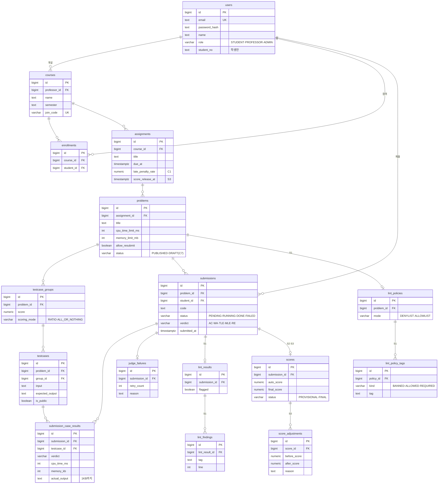

# ERD

core-api가 쓰는 PostgreSQL 스키마 초안. 기획서 v0.6, 기능 명세서 v0.4, API 명세서 V1의 용어(수업 → 과제 → 문제 → 테스트케이스, 제출 → 결과 → 점수)를 그대로 테이블로 옮겼다. `sql/`과 엔티티는 A 영역이라 이 문서는 **B가 쓴 초안**이고 A가 확정한다. 확정 전 항목은 **(미정)**으로 표시했다.

Must 범위의 테이블을 먼저 두고, Should(S1~S4)에서 쓰는 테이블은 따로 묶었다. Must 단계에서는 Should 테이블을 만들지 않아도 된다.

## 1. 관계도

## 2. 공통 규칙 (제안, A 확정)

| 항목 | 규칙 |
| --- | --- |
| 이름 | 테이블·컬럼 모두 `snake_case`, 테이블은 복수형 |
| PK | `bigint generated always as identity` |
| 시각 | `timestamptz`. 모든 테이블에 `created_at` 기본 `now()` |
| 열거형 | PostgreSQL enum 대신 `varchar` + `CHECK`. 값을 추가할 때 마이그레이션이 단순하다 **(미정)** |
| 삭제 | soft delete 없음. 부모 삭제는 `RESTRICT`. 제출의 자식 중 결과성 테이블(`submission_case_results`, `judge_failures`, `lint_results`, `lint_findings`)은 `CASCADE`, 점수(`scores`, `score_adjustments`)는 `RESTRICT` |
| 점수 | `numeric(5,2)`. 소수 둘째 자리 반올림은 애플리케이션에서 |
| 입력 검증 | 길이·범위(제목 1~100자, 시간 100~10000 ms, 메모리 32~512 MB, 학기 `YYYY-N`)는 API 400 검증으로 막는다. DB에는 NOT NULL과 UNIQUE만 둔다 |

### API 필드와 컬럼 이름이 다른 곳

| API | 컬럼 | 이유 |
| --- | --- | --- |
| `timeLimitMs` | `problems.cpu_time_limit_ms` | CPU 시간 기준임을 컬럼 이름에 남긴다(ADR 0004) |
| `resubmitAllowed` | `problems.allow_resubmit` | |
| `executionTimeMs` | `submissions.cpu_time_ms` | 위와 같음 |
| `passedCount` | `submissions.passed_count` | |
| `hiddenPassed` | `submissions.hidden_passed_count` | |
| `hiddenTotal`, `totalCount` | 컬럼 없음 | `testcases`에서 센다 |
| `failedAt` (ADMIN-02) | `judge_failures.failed_at` | |

그 외 API의 camelCase는 같은 이름의 snake_case 컬럼이다(`dueAt` → `due_at`).

## 3. Must 테이블

### users

| 컬럼 | 타입 | 제약 | 비고 |
| --- | --- | --- | --- |
| id | bigint | PK | |
| email | text | UNIQUE, NOT NULL | 로그인 ID |
| password_hash | text | NOT NULL | bcrypt |
| name | text | NOT NULL | |
| role | varchar(16) | NOT NULL, CHECK | `STUDENT` `PROFESSOR` `ADMIN` |
| student_no | text | NULL | 학번. 학생만 |

회원가입이 없어서(C3 전까지) 행은 `sql/seed.sql`로만 생긴다. seed에는 가짜 계정만 넣는다. 로그인 3종은 같은 테이블에서 `role`을 대조한다. 역할 불일치는 `AUTH-003`.

### courses

| 컬럼 | 타입 | 제약 | 비고 |
| --- | --- | --- | --- |
| id | bigint | PK | |
| professor_id | bigint | FK users, NOT NULL | |
| name | text | NOT NULL | |
| semester | text | NOT NULL | `YYYY-N`. 예: `2026-2` |
| join_code | varchar(16) | UNIQUE, NOT NULL | 전체 수업에서 고유. 예: `DS-7K92-QX`. C5 재발급은 이 값을 덮어쓴다 |

응답의 `studentCount`는 `enrollments`를 센다.

### enrollments

| 컬럼 | 타입 | 제약 | 비고 |
| --- | --- | --- | --- |
| id | bigint | PK | |
| course_id | bigint | FK courses, NOT NULL | |
| student_id | bigint | FK users, NOT NULL | |

`UNIQUE (course_id, student_id)`. 이미 참여면 409(COURSE-02). 참여 시각은 공통 `created_at`이다.

### assignments

| 컬럼 | 타입 | 제약 | 비고 |
| --- | --- | --- | --- |
| id | bigint | PK | |
| course_id | bigint | FK courses, NOT NULL | |
| title | text | NOT NULL | |
| due_at | timestamptz | NOT NULL | 마감. 이후 제출은 409(SUB-01) |
| late_penalty_rate | numeric(5,2) | NULL | C1. 값이 있으면 마감 후 제출을 받고 감점 |
| score_release_at | timestamptz | NULL | S3. 이 시각 이후 학생에게 점수 공개. 즉시 공개는 `now()` |

예약 공개(S3)에서 "공개 순간 미확정 점수를 확정"하는 처리를 스케줄러로 할지, 조회 시 `score_release_at <= now()`이면 확정된 것으로 볼지는 **(미정)**.

### problems

| 컬럼 | 타입 | 제약 | 비고 |
| --- | --- | --- | --- |
| id | bigint | PK | |
| assignment_id | bigint | FK assignments, NOT NULL | |
| title | text | NOT NULL | |
| description | text | NOT NULL | |
| input_format | text | NOT NULL | API 필수 |
| output_format | text | NOT NULL | API 필수 |
| cpu_time_limit_ms | int | NOT NULL | CPU 시간 기준(ADR 0004). API `timeLimitMs` |
| memory_limit_mb | int | NOT NULL | |
| allow_resubmit | boolean | NOT NULL DEFAULT true | false면 두 번째 제출 409 |
| status | varchar(16) | NOT NULL, CHECK | `PUBLISHED`. C7에서 `DRAFT` 추가 |
| order_no | int | NOT NULL | 과제 안 표시 순서 |

### testcase_groups

| 컬럼 | 타입 | 제약 | 비고 |
| --- | --- | --- | --- |
| id | bigint | PK | |
| problem_id | bigint | FK problems, NOT NULL | |
| name | text | NULL | |
| score | numeric(5,2) | NOT NULL | 그룹 배점. 합이 문제 배점 |
| scoring_mode | varchar(16) | NOT NULL, CHECK | `RATIO`(통과 비율) `ALL_OR_NOTHING`(전체 통과) |
| order_no | int | NOT NULL | |

`UNIQUE (id, problem_id)`. 아래 testcases의 복합 FK가 참조한다.

Must의 문제 등록 API에는 그룹 입력이 없다. 등록 시 그룹 1개(배점 100, `RATIO`)를 서버가 만들어 모든 케이스를 넣는다(PROB-05). S2에서 교수가 나눈다. 처음부터 테이블을 두는 이유는 나중에 넣으면 테스트케이스와 조회 로직을 함께 고쳐야 하기 때문이다(기획서 5절).

### testcases

| 컬럼 | 타입 | 제약 | 비고 |
| --- | --- | --- | --- |
| id | bigint | PK | |
| problem_id | bigint | FK problems, NOT NULL | 그룹을 거치지 않고 바로 조회하려고 중복 보유 |
| group_id | bigint | FK testcase_groups, NOT NULL | |
| input | text | NOT NULL | |
| expected_output | text | NOT NULL | |
| is_public | boolean | NOT NULL | 비공개는 학생에게 통과 개수만 |
| order_no | int | NOT NULL | 응답의 `testcases[].no` |

`UNIQUE (problem_id, order_no)`. `problem_id`가 그룹의 문제와 어긋나지 않도록 `FOREIGN KEY (group_id, problem_id) REFERENCES testcase_groups (id, problem_id)`를 건다. 케이스 1건 이상은 API 검증으로 막는다. 제출이 생긴 문제의 케이스 수정은 C7 범위 밖.

### submissions

| 컬럼 | 타입 | 제약 | 비고 |
| --- | --- | --- | --- |
| id | bigint | PK | 큐 메시지의 `submission_id` |
| problem_id | bigint | FK problems, NOT NULL | |
| student_id | bigint | FK users, NOT NULL | |
| code | text | NOT NULL, CHECK `octet_length(code) <= 65536` | 64KB 상한(SUBMISSION-004) |
| status | varchar(16) | NOT NULL, CHECK | `PENDING` `RUNNING` `DONE` `FAILED`. API와 같은 값 |
| verdict | varchar(8) | NULL, CHECK | `AC` `WA` `TLE` `MLE` `RE`. `DONE`일 때만 |
| cpu_time_ms | int | NULL | 케이스 중 최댓값. API `executionTimeMs` |
| memory_kb | int | NULL | 케이스 중 최댓값 |
| passed_count | int | NULL | 통과 케이스 수. 목록 화면용 요약값 |
| hidden_passed_count | int | NULL | 비공개 케이스 통과 수 |
| submitted_at | timestamptz | NOT NULL | |
| judged_at | timestamptz | NULL | 결과 반영 시각. `DONE`·`FAILED`에서 채운다 |

인덱스 `(problem_id, student_id, submitted_at DESC)`. 제출 이력(RES-01)과 "성적 대상 = 마지막 제출" 조회가 이 인덱스를 탄다. 성적 대상 여부는 컬럼으로 두지 않고 최신 행으로 계산한다 **(미정: 조회가 복잡하면 `is_latest` 컬럼 추가)**.

`RUNNING`은 judge-worker가 채점 컨테이너를 띄우기 직전 `result.queue`로 보내는 `JudgeStarted`로 바꾼다. `PENDING`일 때만 전이하고, 늦게 오면 무시한다. 상태 전이 규칙 전체는 `contracts/README.md`의 멱등 표를 따른다.

FLAG는 `verdict` 값이 아니다. 기획서대로 판정과 분리해 `lint_results.flagged`에 둔다. 역할 분담 문서의 Verdict 목록에는 FLAG가 들어 있어 contracts 정의 때 맞춘다.

### submission_case_results

| 컬럼 | 타입 | 제약 | 비고 |
| --- | --- | --- | --- |
| id | bigint | PK | |
| submission_id | bigint | FK submissions ON DELETE CASCADE, NOT NULL | |
| testcase_id | bigint | FK testcases, NOT NULL | |
| verdict | varchar(8) | NOT NULL, CHECK | `AC` `WA` `TLE` `MLE` `RE` `SKIPPED`. `SKIPPED`는 앞 케이스에서 컨테이너가 죽어 실행하지 못한 케이스(contracts). 이때 측정값 두 컬럼은 NULL |
| cpu_time_ms | int | NULL | API `timeMs` |
| memory_kb | int | NULL | |
| actual_output | text | NULL | 학생의 실제 출력. API가 1KB까지 돌려주므로 저장도 1KB에서 자른다 |

`UNIQUE (submission_id, testcase_id)`. 비공개 케이스 행도 저장한다. 마감 전에는 API가 개수만 내려주고, 마감 후에는 행을 그대로 내려준다(RES-02).

### judge_failures

| 컬럼 | 타입 | 제약 | 비고 |
| --- | --- | --- | --- |
| id | bigint | PK | |
| submission_id | bigint | FK submissions ON DELETE CASCADE, UNIQUE, NOT NULL | 최종 실패한 제출당 한 행 |
| retry_count | int | NOT NULL | 재시도 횟수. API `retryCount` |
| reason | text | NOT NULL | `JudgeResult.error`의 `code: message`. dead letter 경로면 `delivery_limit`. 학생 코드의 RE는 제외 |
| failed_at | timestamptz | NOT NULL | 최종 실패 시각 |

ADMIN-02 응답(`submissionId, problemId, failedAt, reason, retryCount`)과 1:1이라 집계가 필요 없다. 시도별 이력이 필요해지면 행을 시도마다 두고 API에서 집계한다. SUB-02 규칙대로 3회 재시도 후 `submissions.status = FAILED`가 되면서 이 행이 생긴다. 경로는 둘이다. judge-worker가 4회째 시도에서 `JudgeResult status=FAILED`를 보내면 core-api가 `error`를 `reason`에, `attempt - 1`을 `retry_count`에 적는다. 워커가 죽어 브로커 `delivery-limit`에 걸리면 core-api의 `judge.dlq` 소비자가 `reason = delivery_limit`, `retry_count = x-delivery-count`로 적는다(`contracts/README.md`).

## 4. Should 테이블

### lint_policies, lint_policy_tags (S1)

| 테이블 | 컬럼 | 비고 |
| --- | --- | --- |
| lint_policies | id, problem_id FK UNIQUE, mode | 문제당 하나. `DENYLIST`(기본) `ALLOWLIST` |
| lint_policy_tags | id, policy_id FK, kind, tag | `kind`: `BANNED` `ALLOWED` `REQUIRED`. `UNIQUE (policy_id, kind, tag)` |

`call:eval`, `call:getattr`는 lint-worker가 항상 금지 목록에 더한다(contracts). 행으로 저장하지 않는다.

### lint_results, lint_findings (S1)

| 테이블 | 컬럼 | 비고 |
| --- | --- | --- |
| lint_results | id, submission_id FK CASCADE UNIQUE, status, flagged, checked_at | 제출당 하나. `status`: `DONE` `SKIPPED`(파싱 불가, 이때 `flagged = false`). Must에서는 행이 없고 API의 `flagged`는 항상 `false` |
| lint_findings | id, lint_result_id FK CASCADE, kind, tag, line, col, snippet | `kind`: `BANNED` `NOT_ALLOWED` `MISSING_REQUIRED`. 교수만 본다 |

### scores, score_adjustments (S2·S3)

| 테이블 | 컬럼 | 비고 |
| --- | --- | --- |
| scores | id, submission_id FK RESTRICT UNIQUE, auto_score, final_score, status, finalized_by FK users, finalized_at | 성적 대상 제출당 하나. `status`: `PROVISIONAL` `FINAL`. 공개 시 미확정은 `auto_score`로 확정 |
| score_adjustments | id, score_id FK RESTRICT, before_score, after_score, reason NOT NULL, adjusted_by FK users, adjusted_at | 조정마다 한 행. 공개 뒤 수정도 여기 남는다 |

점수는 과제가 아니라 **문제(제출) 단위**로 저장하고 과제 점수는 합산한다. RES-04의 API가 `PATCH /professor/submissions/{id}/score`라 이 단위가 맞다. C1(지각 제출)을 켜면 조정 뒤에 새 제출이 들어와 성적 대상이 바뀔 수 있다. 그때 조정을 어떻게 옮길지는 C1 착수 때 정한다.

### testcase_generation_requests (S4)

모범답안으로 기대 출력을 만드는 비동기 요청. `id, professor_id FK, code, inputs jsonb, status, results jsonb, created_at`. 채점 큐를 거치므로 요청 후 조회한다(PROB-06). 문제와 연결되기 전 단계라 FK가 없다. 구조는 S4 착수 때 정한다 **(미정)**.

## 5. 결과 수신 멱등

큐는 at-least-once라 같은 결과가 두 번 올 수 있다(ADR 0001). 결과 종류마다 제약 하나로 막는다.

| 결과 | 멱등 수단 |
| --- | --- |
| JudgeResult | `submissions.judged_at IS NULL`인 행만 갱신. 케이스 결과는 `UNIQUE (submission_id, testcase_id)`로 중복 삽입 거부 |
| 채점 실패 | `judge_failures.submission_id UNIQUE` |
| LintResult | `lint_results.submission_id UNIQUE` |

## 6. 주요 조회와 인덱스

| 기능 | 조회 | 인덱스 |
| --- | --- | --- |
| PROB-03 학생 문제 목록 | 문제마다 내 최신 제출의 판정·통과 수 | `submissions (problem_id, student_id, submitted_at DESC)` |
| RES-03 채점 검토 | 과제의 학생별 최신 제출 (미제출도 행으로) | 위 인덱스 + `enrollments (course_id)` |
| COURSE-02 수업 참여 | 참여 코드로 수업 찾기 | `courses.join_code UNIQUE` |
| ADMIN-01 `todayJudged`, `avgJudgeTimeMs` | 오늘 `judged_at` 건수, 최근 1시간 `judged_at - submitted_at` 평균 | `submissions (judged_at)` |
| ADMIN-02 실패 이력 | 최신순, 페이지 | `judge_failures (failed_at DESC)` |

큐 적재량과 워커(소비자) 수(ADMIN-01)는 DB가 아니라 RabbitMQ 관리 API에서 읽는다.

## 관련 문서

- 용어와 규칙: Notion 기획서 4·6절, 기능 명세서, API 명세서 V1
- 큐 메시지: `contracts/`, ADR 0001
- 스키마 적용 방식(Flyway 여부): ADR 0005, A와 논의 중
